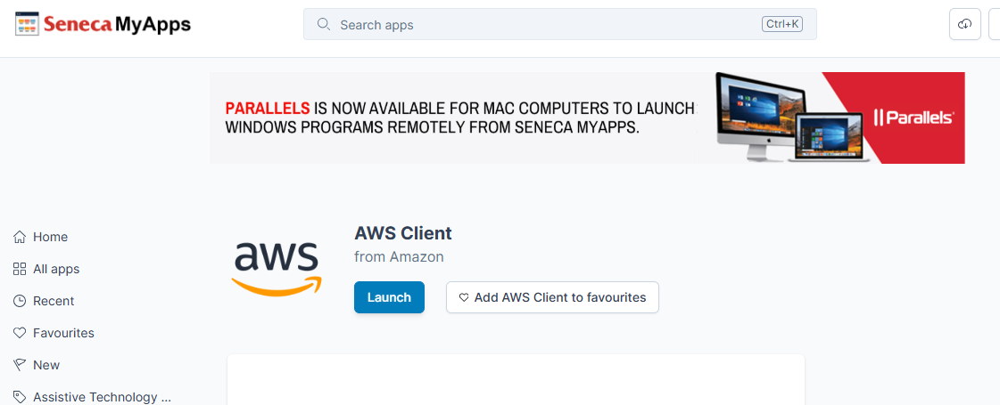

# Chapter Six: Programming with AWS

Until now every program you wrote used only what comes with Python and ran entirely on your own computer. Real programs rarely work that way. They read their **settings** from outside the code, they pull in **libraries** written by other people, and they talk to services running **in the cloud**. In this chapter you will learn what **environment variables** are and how to set them, install your first external library, connect the **AWS CLI** on Windows to your **AWS Academy** account, and then write a Python program that creates an **Amazon S3** bucket, uploads a file to it, and downloads the file again.

[← Back to Course Index](../table-of-contents.md)

---

## Chapter Goals

In this chapter you will **learn**:

- To understand **environment variables** and set them in Windows and in **PyCharm**
- To read environment variables from Python with the **`os`** module
- To find, install, and manage **external libraries** with **pip**
- To install the **AWS CLI** on Windows and configure it with **AWS Academy** credentials
- To use **boto3** to connect to **Amazon S3** from Python
- To create a bucket, upload a file, list a bucket's contents, and download a file

---

## Chapter Contents

- **6.1 Environment Variables** — What they are, reading them in Python, and setting them in Windows and PyCharm
- **6.2 External Libraries** — The standard library vs. external libraries, PyPI, pip, virtual environments, and `requirements.txt`
- **6.3 The AWS CLI and AWS Academy Credentials** — Installing the CLI on Windows, copying your lab credentials, and checking the connection
- **6.4 Connecting to S3 from Python** — boto3, how it finds your credentials, and listing your buckets
- **6.5 Create, Upload, Download** — A complete S3 program, cleaning up, and common errors

---

## 6.1 Environment Variables

### What Is an Environment Variable?

An **environment variable** is a **name = value** pair that the operating system hands to every program it starts. The program can look the value up by name while it runs.

Windows already has many. A few you can see right now:

| Name          | Example value                    | Meaning                              |
| ------------- | -------------------------------- | ------------------------------------ |
| `USERNAME`    | `jsmith`                         | The logged-in user                   |
| `USERPROFILE` | `C:\Users\jsmith`                | That user's home folder              |
| `PATH`        | `C:\Windows\system32;...`        | Folders Windows searches for programs |

Try it in a **Command Prompt**:

```text
echo %USERNAME%
```

or in **PowerShell** (the default terminal in PyCharm on Windows):

```text
echo $env:USERNAME
```

### Why Use Them?

Environment variables let you change how a program behaves **without changing its code**. They are the standard place for two kinds of values:

- **Settings that differ between computers or runs** — a bucket name, a region, "test" vs. "production"
- **Secrets** — passwords, API keys, access tokens. A secret written into a `.py` file ends up wherever the file goes: emailed to a classmate, uploaded to GitHub, pasted into a forum. A secret kept in an environment variable stays on your machine.

You will use both kinds with AWS: the **bucket name** is a setting, and your **AWS credentials** are secrets.

### Reading Environment Variables in Python

The `os` module comes with Python. It gives you `os.environ`, which holds every environment variable the program received:

```python
import os

course = os.environ.get("COURSE_NAME", "unknown course")
print(f"Welcome to {course}!")

pizza_count = int(os.environ.get("PIZZA_COUNT", "1"))
print(f"Ordering {pizza_count} pizza(s), that's {pizza_count * 8} slices.")
```

`os.environ.get(name, default)` returns the variable's value, or `default` if the variable is not set. If you leave out the default, it returns `None`.

Run it with no variables set:

```text
Welcome to unknown course!
Ordering 1 pizza(s), that's 8 slices.
```

Run it again with `COURSE_NAME=PFC710` and `PIZZA_COUNT=3` (you will see how in a moment):

```text
Welcome to PFC710!
Ordering 3 pizza(s), that's 24 slices.
```

Same code, different output.

> **Note:** The value of an environment variable is **always a string**, even when it looks like a number. That is why the program converts `PIZZA_COUNT` with `int()` — just as you do with the result of `input()`.

### ⚠️ Common Error: `KeyError`

You can also read a variable with square brackets, `os.environ["COURSE_NAME"]`. If it is not set, the program stops with an error:

```text
KeyError: 'COURSE_NAME'
```

Use `os.environ.get(...)` when the variable is optional, and check for `None` when it is required (you will see this in §6.5).

### Setting Environment Variables in PyCharm

The easiest place to set a variable for a program you are developing is its **run configuration**:

1. Run the script once so PyCharm creates a run configuration for it.
2. Open **Run → Edit Configurations…** and select your script on the left.
3. Find the **Environment variables** field. It already contains `PYTHONUNBUFFERED=1` — leave that there.
4. Add your variables, separated by semicolons:

   ```text
   PYTHONUNBUFFERED=1;COURSE_NAME=PFC710;PIZZA_COUNT=3
   ```

   Or click the small icon at the right end of the field to edit them in a table, one row per variable.
5. Click **OK** and run the script again.

These variables apply **only to that run configuration** — they are not visible to other scripts or to the terminal.

### Setting Environment Variables in Windows

**For one terminal window only.** The variable disappears when you close the window.

Command Prompt:

```text
set COURSE_NAME=PFC710
python env_demo.py
```

PowerShell:

```text
$env:COURSE_NAME = "PFC710"
python env_demo.py
```

**Permanently, for your Windows account.** Either run

```text
setx COURSE_NAME PFC710
```

or search the Start menu for **Edit environment variables for your account** and add it under **User variables**.

A permanent variable is only seen by programs started **after** you set it. Close and reopen the terminal — and **restart PyCharm** — before you test it.

> **macOS / Linux:** the one-window command is `export COURSE_NAME=PFC710`.

---

## 6.2 External Libraries

### The Standard Library

Python comes with a large **standard library** — modules that are installed along with Python itself. You have already used some of them:

```python
import math     # sqrt, pi, ...
import random   # randint, choice, ...
import os       # operating-system features (you used it in §6.1)
```

Nothing has to be downloaded for these; `import` just works.

### What Are External Libraries?

**External libraries** (also called **third-party libraries** or **packages**) are written by people outside the Python team and published for anyone to use. They add features the standard library does not have:

| Library      | What it does                                   |
| ------------ | ---------------------------------------------- |
| `requests`   | Sends HTTP requests to websites and web APIs   |
| `boto3`      | Talks to Amazon Web Services (AWS) — this chapter |
| `numpy`      | Fast numerical computation                     |
| `pandas`     | Data analysis with tables                      |
| `matplotlib` | Plotting graphs                                |

**Why use them?**

- **Save time** by reusing code that thousands of people already rely on
- **Get features** that are not in the standard library
- **Avoid reinventing the wheel** — talking to AWS correctly takes a lot of code; `boto3` has already written it

### Finding Libraries on PyPI

Packages are published on the **Python Package Index (PyPI)** at [https://pypi.org](https://pypi.org). Search by name or by what you need (for example, "aws" or "plotting"). Each package's page shows its description, its latest version, and the command to install it.

### Installing a Package with pip

**pip** is the tool that downloads packages from PyPI and installs them. It comes with Python.

Open the **Terminal** in PyCharm (the terminal icon in the bottom-left tool bar) and run:

```text
pip install requests
```

pip downloads `requests` **and its dependencies** — other packages that `requests` itself needs — and installs them all.

Other useful pip commands:

| Command                           | What it does                                          |
| --------------------------------- | ----------------------------------------------------- |
| `pip list`                        | Lists every package installed in this environment     |
| `pip show requests`               | Shows the version and details of one package          |
| `pip install --upgrade requests`  | Upgrades a package to its latest version              |
| `pip uninstall requests`          | Removes a package                                     |

> **Tip:** You can also install packages without typing commands. In PyCharm, open the **Python Packages** tool window (bottom-left tool bar), search for the package, and click **Install**. And if you write `import requests` before installing it, PyCharm underlines it in red — hover over it and choose **Install package requests**.

### Using the Package

Once it is installed, you import an external library exactly like a standard one:

```python
import requests

response = requests.get("https://www.python.org")

print(f"Status code: {response.status_code}")
print(f"Received {len(response.text)} characters")
```

```text
Status code: 200
Received 51858 characters
```

A status code of **200** means the request succeeded. (The number of characters will be different for you — it changes whenever the page changes.)

### Virtual Environments

When you create a new project, PyCharm gives it its own **virtual environment** — a private copy of Python stored in a folder named `.venv` inside the project. Packages you install go into **that project's** environment only.

This is a good thing: one project can use one version of a library while another project uses a different version, and they never interfere. But it also explains one of the most common beginner errors.

### ⚠️ Common Error: `ModuleNotFoundError`

```text
ModuleNotFoundError: No module named 'boto3'
```

Python could not find the package **in the environment this program is running in**. Either you have not installed it yet, or you installed it into a different environment (for example, from a Windows Command Prompt instead of PyCharm's terminal).

To fix it:

1. Check the interpreter in the bottom-right corner of the PyCharm window — it should name your project's `.venv`.
2. Install the package from **PyCharm's** terminal (the prompt starts with `(.venv)` when the project environment is active), or from the **Python Packages** window.

### Recording Dependencies in `requirements.txt`

If someone else downloads your project, how do they know which packages to install? You list them in a plain-text file called **`requirements.txt`**, one package per line:

```text
boto3==1.43.112
requests==2.34.2
```

`==` pins an exact version. Generate the file from what is installed in your environment:

```text
pip freeze > requirements.txt
```

and install everything in it with one command:

```text
pip install -r requirements.txt
```

---

## 6.3 The AWS CLI and AWS Academy Credentials

### What Is the AWS CLI?

The **AWS Command Line Interface (CLI)** is a program that lets you control AWS by typing commands instead of clicking in the web console. For this course it has two jobs:

1. It **saves your AWS credentials** in a place on your computer where both the CLI and Python can find them.
2. It gives you a quick way to **check that the credentials work** before you write any Python.

### Installing the AWS CLI on Windows

How you get the CLI depends on which computer you are using.

**On your own computer:**

1. Download the installer: [https://awscli.amazonaws.com/AWSCLIV2.msi](https://awscli.amazonaws.com/AWSCLIV2.msi)
2. Run it and accept the defaults.

**On a Seneca lab computer** you cannot run installers. Get the CLI from Seneca MyApps instead:

1. Go to [https://myapps.senecapolytechnic.ca/](https://myapps.senecapolytechnic.ca/) and sign in with your Seneca account.
2. Search for **AWS Client**, open it, and click **Launch**.



**Then, on either computer**, open a **new** Command Prompt or PowerShell window (one that was open before the CLI was installed will not find the new program) and run:

```text
aws --version
```

You should see something like:

```text
aws-cli/2.27.54 Python/3.13.4 Windows/11 exe/AMD64
```

The exact version numbers will differ. If you get `'aws' is not recognized as an internal or external command`, close **all** terminals (and PyCharm) and open a new one.

### Getting Your AWS Academy Credentials

AWS Academy does not give you a permanent AWS account. Each time you start the lab, it gives you **temporary credentials** made of **three** parts:

| Part                  | Looks like                    | Meaning                                         |
| --------------------- | ----------------------------- | ----------------------------------------------- |
| **Access key ID**     | `ASIA...` (20 characters)     | Who you are — like a user name                  |
| **Secret access key** | 40 random characters          | Proves it is you — like a password              |
| **Session token**     | A very long string            | Proves this temporary session is still valid    |

To copy them:

1. Open your **AWS Academy Learner Lab** and click **Start Lab**.
2. Wait until the circle next to **AWS** turns **green**.
3. Click **AWS Details**.
4. Next to **AWS CLI**, click **Show**. You will see a block like this (your values will be different and much longer):

   ```ini
   [default]
   aws_access_key_id=ASIAEXAMPLEEXAMPLE12
   aws_secret_access_key=exampleSecretKeyexampleSecretKeyexample1
   aws_session_token=IQoJb3JpZ2luX2VjEExampleTokenExampleToken...
   ```

5. Note the region, shown on the same page. In the Learner Lab it is normally **`us-east-1`**.

> **⚠️ The credentials expire.** They stop working when the lab session ends (the timer shows the time left, normally 4 hours), and you get **new** ones every time you start the lab. Expect to repeat the next step at the start of every lab session.

### Saving the Credentials

The CLI keeps its settings in a folder named `.aws` in your home folder (`C:\Users\<your user name>\.aws\`), in two files:

| File          | Holds                                                      |
| ------------- | ---------------------------------------------------------- |
| `credentials` | Access key ID, secret access key, and session token        |
| `config`      | Default region and output format                           |

**Step 1 — run `aws configure` once.** It creates the folder and both files. Paste the access key ID and secret key from AWS Details when asked, type `us-east-1` for the region and `json` for the output format:

```text
aws configure
```

```text
AWS Access Key ID [None]: ASIAEXAMPLEEXAMPLE12
AWS Secret Access Key [None]: exampleSecretKeyexampleSecretKeyexample1
Default region name [None]: us-east-1
Default output format [None]: json
```

`aws configure` does **not** ask for the session token, and Academy credentials do not work without it.

**Step 2 — paste the whole block into the `credentials` file.** In Command Prompt:

```text
notepad %USERPROFILE%\.aws\credentials
```

(In PowerShell: `notepad $HOME\.aws\credentials`.)

Delete everything in the file, paste the **entire block** you copied from AWS Details — `[default]` line, all three lines, session token included — and save.

**Every new lab session**, repeat step 2 only: copy the block from AWS Details again and replace the contents of `credentials`. The region in `config` stays the same.

> **Alternative to step 2:** you can store the token from the command line with
> `aws configure set aws_session_token <paste token here>`. Pasting the whole block in Notepad is less error-prone, because all three values always come from the same session.

### Checking the Connection

Ask AWS who you are:

```text
aws sts get-caller-identity
```

If the credentials work, you will see something like:

```json
{
    "UserId": "AROAEXAMPLEID:user1234567=Jane_Smith",
    "Account": "123456789012",
    "Arn": "arn:aws:sts::123456789012:assumed-role/voclabs/user1234567=Jane_Smith"
}
```

The `voclabs` role is the role AWS Academy gives you. Then list your S3 buckets (you may not have any yet, in which case nothing is printed):

```text
aws s3 ls
```

To see **where** the CLI is reading each value from:

```text
aws configure list
```

```text
      Name                    Value             Type    Location
      ----                    -----             ----    --------
   profile                <not set>             None    None
access_key     ****************MPLE shared-credentials-file
secret_key     ****************ple1 shared-credentials-file
    region                us-east-1      config-file    ~/.aws/config
```

`shared-credentials-file` means the keys came from your `credentials` file. If the **Type** column says `env` instead, see the next error.

### ⚠️ Common Errors When Connecting

| Error message (last line)                                                                         | Cause and fix                                                                                                                       |
| ------------------------------------------------------------------------------------------------- | ----------------------------------------------------------------------------------------------------------------------------------- |
| `Unable to locate credentials`                                                                    | There is no `credentials` file, or it is empty or misnamed (for example `credentials.txt`). Repeat the steps above.                 |
| `An error occurred (ExpiredToken) ... The provided token has expired.`                            | The lab session ended. Start the lab again and paste the new block into `credentials`.                                              |
| `An error occurred (InvalidClientTokenId) ... The security token included in the request is invalid.` | The session token is missing, or the three values came from different sessions. Paste the **whole** block again.              |
| `An error occurred (InvalidAccessKeyId) ... does not exist in our records.`                       | Usually stale credentials in **environment variables**. Run `aws configure list` — if the Type says `env`, see below.              |

**Environment variables win.** The CLI (and Python, in §6.4) also accept credentials from the environment variables `AWS_ACCESS_KEY_ID`, `AWS_SECRET_ACCESS_KEY` and `AWS_SESSION_TOKEN`, and they look there **before** they look at the `credentials` file. If you set those once in an earlier session, the old, expired values hide your fresh ones. Delete them (see §6.1) and open a new terminal.

### Trying S3 from the CLI

Before writing Python, you can try the three operations this chapter is about straight from the terminal. Bucket names must be **globally unique** across all AWS accounts, so put your own user name in it:

```text
aws s3 mb s3://pfc710-jsmith-cli-test
aws s3 cp hello.txt s3://pfc710-jsmith-cli-test/notes/hello.txt
aws s3 ls s3://pfc710-jsmith-cli-test --recursive
aws s3 cp s3://pfc710-jsmith-cli-test/notes/hello.txt hello_copy.txt
aws s3 rb s3://pfc710-jsmith-cli-test --force
```

`mb` makes a bucket, `cp` copies a file up or down, `ls` lists, and `rb --force` removes the bucket and everything in it. Now let's do the same from Python.

### 🔒 Keep Your Credentials Secret

- **Never** paste your keys into a `.py` file, a screenshot, an email, or a chat.
- **Never** commit the `.aws` folder, or any file containing keys, to Git.
- If you think a key leaked, end the lab session — the temporary credentials become useless.

---

## 6.4 Connecting to S3 from Python

### Amazon S3: Buckets, Objects, and Keys

**Amazon S3** (Simple Storage Service) stores files in the cloud.

| Term       | Meaning                                                                    | Example                          |
| ---------- | -------------------------------------------------------------------------- | -------------------------------- |
| **Bucket** | A container for files. Its name is unique across **all** of AWS.           | `pfc710-jsmith-demo`             |
| **Object** | One file stored in a bucket.                                               | the contents of `hello.txt`      |
| **Key**    | The object's name inside the bucket. It may contain `/` to look like folders. | `notes/hello.txt`             |

**Bucket name rules:** 3–63 characters; only **lowercase** letters, digits, hyphens (`-`), and dots (`.`); must start and end with a letter or digit; and no one else in the world may already be using it. A name such as `pfc710-<your user name>-demo` is a good choice.

### Installing boto3

**boto3** is the official AWS library for Python — the AWS SDK (Software Development Kit). It is an external library, so install it in your project's terminal (§6.2):

```text
pip install boto3
```

### How boto3 Finds Your Credentials

boto3 uses **the same credentials as the AWS CLI**. When your program connects, it looks for them in this order and uses the first one it finds:

1. **Environment variables** — `AWS_ACCESS_KEY_ID`, `AWS_SECRET_ACCESS_KEY`, `AWS_SESSION_TOKEN`
2. **The `credentials` file** in your `.aws` folder (§6.3)

So if `aws s3 ls` works in the terminal, your Python program will work too — and your code contains **no keys at all**.

> **Option: credentials in PyCharm instead.** You can skip the `credentials` file and put the three values in your run configuration's **Environment variables** field (§6.1):
>
> ```text
> AWS_ACCESS_KEY_ID=ASIA...;AWS_SECRET_ACCESS_KEY=...;AWS_SESSION_TOKEN=...;AWS_DEFAULT_REGION=us-east-1
> ```
>
> This works, but you will have to update every run configuration each lab session, and these values override the `credentials` file (§6.3). The `credentials` file is one place to update for the CLI and every program, so it is the approach this course uses.

### Creating a Client

To talk to an AWS service, you create a **client** for it:

```python
import boto3

s3 = boto3.client("s3")
```

`s3` is now an object with a method for every S3 operation: `create_bucket`, `upload_file`, `download_file`, and many more.

### Your First Program: Listing Your Buckets

```python
import boto3

s3 = boto3.client("s3")

response = s3.list_buckets()
buckets = response["Buckets"]

print(f"You have {len(buckets)} bucket(s).")
for bucket in buckets:
    print(bucket["Name"])
```

If you have one bucket, the output looks like:

```text
You have 1 bucket(s).
pfc710-jsmith-demo
```

AWS sends back its answer as a **dictionary** — a collection where each value is looked up by a **name** (called a **key**) instead of by a position. `response["Buckets"]` reads the value named `"Buckets"`, which is a **list** of buckets, and `bucket["Name"]` reads each bucket's name. You will study dictionaries in detail in a later chapter; for now, reading a value by its name in square brackets is all you need.

If this program prints your buckets (or `You have 0 bucket(s).`), your Python–AWS connection works.

### ⚠️ Common Error: `NoCredentialsError`

```text
botocore.exceptions.NoCredentialsError: Unable to locate credentials
```

boto3 found no credentials in the environment variables or the `credentials` file. Go back to §6.3 and make sure `aws sts get-caller-identity` works first. If it works in a terminal but not in PyCharm, restart PyCharm.

### A Note on Argument Names

S3 methods take **keyword arguments** (§4.3) whose names start with a capital letter:

```python
s3.create_bucket(Bucket="pfc710-jsmith-demo")
```

`Bucket`, `Key`, and the dictionary names `Buckets` and `Name` are **AWS's** names, and you must spell them exactly as AWS does. This is not an exception to the naming rules for **your** code: your own variables and functions are still `snake_case` — `bucket_name`, not `BucketName`.

---

## 6.5 Create, Upload, Download

### Creating a Bucket

```python
s3.create_bucket(Bucket="pfc710-jsmith-demo")
```

That is all it takes in `us-east-1`, the Learner Lab's region.

> **Other regions:** outside `us-east-1`, you must also tell S3 where to put the bucket:
>
> ```python
> s3.create_bucket(
>     Bucket="pfc710-jsmith-demo",
>     CreateBucketConfiguration={"LocationConstraint": "us-west-2"},
> )
> ```

In `us-east-1`, calling `create_bucket` again for a bucket **you** already own succeeds without complaint, so a program that creates its bucket every time it runs is fine. If **someone else** owns the name, you get a `BucketAlreadyExists` error — choose another name.

### Uploading a File

```python
s3.upload_file("hello.txt", "pfc710-jsmith-demo", "notes/hello.txt")
```

The three arguments are, in order:

1. The **local file** to upload
2. The **bucket** to upload it to
3. The **key** to store it under

A relative file name such as `hello.txt` is looked up in the program's **working directory** — in PyCharm, by default, the folder that contains your script. Put `hello.txt` next to the `.py` file.

### Listing a Bucket's Contents

```python
response = s3.list_objects_v2(Bucket="pfc710-jsmith-demo")
objects = response.get("Contents", [])
for item in objects:
    print(f"{item['Key']} ({item['Size']} bytes)")
```

When the bucket is empty, AWS leaves `"Contents"` out of the response entirely. `response.get("Contents", [])` works like `os.environ.get` in §6.1: it returns the value if it is there, and the default — an empty list — if it is not.

### Downloading a File

```python
s3.download_file("pfc710-jsmith-demo", "notes/hello.txt", "hello_downloaded.txt")
```

The arguments are the **bucket**, the **key**, and the **local file** to save it as — the reverse of `upload_file`. If the local file already exists, it is replaced.

### The Complete Program

Create a new PyCharm project with boto3 installed, then:

1. Create a file named **`hello.txt`** (right-click the project → **New → File**) and type a couple of lines into it, for example:

   ```text
   Hello from PFC710!
   This file travelled to S3 and back.
   ```

2. Create **`s3_demo.py`**:

```python
"""Creates an S3 bucket, uploads a file to it, lists it, and downloads it again."""

import os

import boto3

LOCAL_FILE = "hello.txt"
OBJECT_KEY = "notes/hello.txt"
DOWNLOADED_FILE = "hello_downloaded.txt"


def create_bucket(s3, bucket_name):
    """Creates a bucket in us-east-1."""
    s3.create_bucket(Bucket=bucket_name)
    print(f"Created bucket {bucket_name}")


def upload_file(s3, bucket_name, file_name, key):
    """Uploads a local file to the bucket under the given key."""
    s3.upload_file(file_name, bucket_name, key)
    print(f"Uploaded {file_name} as {key}")


def list_objects(s3, bucket_name):
    """Prints the key and size of every object in the bucket."""
    response = s3.list_objects_v2(Bucket=bucket_name)
    objects = response.get("Contents", [])
    print(f"{bucket_name} contains {len(objects)} object(s):")
    for item in objects:
        print(f"  {item['Key']} ({item['Size']} bytes)")


def download_file(s3, bucket_name, key, file_name):
    """Downloads an object from the bucket to a local file."""
    s3.download_file(bucket_name, key, file_name)
    print(f"Downloaded {key} to {file_name}")


def main():
    bucket_name = os.environ.get("BUCKET_NAME")
    if bucket_name is None:
        print("Set the BUCKET_NAME environment variable first.")
        return

    s3 = boto3.client("s3")
    create_bucket(s3, bucket_name)
    upload_file(s3, bucket_name, LOCAL_FILE, OBJECT_KEY)
    list_objects(s3, bucket_name)
    download_file(s3, bucket_name, OBJECT_KEY, DOWNLOADED_FILE)


main()
```

3. Run it once. Because `BUCKET_NAME` is not set yet, it prints:

   ```text
   Set the BUCKET_NAME environment variable first.
   ```

4. Open **Run → Edit Configurations…** and add `BUCKET_NAME=pfc710-<your user name>-demo` to the **Environment variables** field (§6.1). Run it again:

   ```text
   Created bucket pfc710-jsmith-demo
   Uploaded hello.txt as notes/hello.txt
   pfc710-jsmith-demo contains 1 object(s):
     notes/hello.txt (55 bytes)
   Downloaded notes/hello.txt to hello_downloaded.txt
   ```

   The size depends on exactly what you typed (Windows line endings add a byte per line).

5. Check the result two ways:
   - **In PyCharm:** `hello_downloaded.txt` has appeared in the project. Open it — it contains exactly what you typed into `hello.txt`.
   - **In the AWS Console:** open **S3**, click your bucket, then the `notes/` folder. `hello.txt` is there.

Notice what the program does **not** contain: no access keys and no hard-coded bucket name. The credentials come from your `credentials` file and the bucket name comes from an environment variable, so you can hand this file to a classmate and it will work with **their** account and **their** bucket.

### Cleaning Up

A bucket can only be deleted when it is **empty**, so delete the objects first:

```python
import os

import boto3

bucket_name = os.environ["BUCKET_NAME"]
s3 = boto3.client("s3")

s3.delete_object(Bucket=bucket_name, Key="notes/hello.txt")
print("Deleted notes/hello.txt")

s3.delete_bucket(Bucket=bucket_name)
print(f"Deleted bucket {bucket_name}")
```

```text
Deleted notes/hello.txt
Deleted bucket pfc710-jsmith-demo
```

This script uses `os.environ[...]` instead of `.get(...)` on purpose: without a bucket name there is nothing sensible to do, so stopping with a `KeyError` is fine. Remember to add `BUCKET_NAME` to **this** script's run configuration too — each run configuration has its own variables.

### ⚠️ Common Errors with S3

When something goes wrong, read the **last line** of the error output — it names the problem.

| Last line of the error                                                                                                  | Cause and fix                                                                                         |
| ----------------------------------------------------------------------------------------------------------------------- | ----------------------------------------------------------------------------------------------------- |
| `FileNotFoundError: [Errno 2] No such file or directory: 'helo.txt'`                                                    | The local file name is misspelled, or the file is not in the same folder as the script.               |
| `boto3.exceptions.S3UploadFailedError: Failed to upload hello.txt to pfc710-no-such-bucket/notes/hello.txt: An error occurred (NoSuchBucket) when calling the PutObject operation: The specified bucket does not exist` | The bucket name is wrong, or you have not created the bucket yet.                |
| `botocore.exceptions.ClientError: An error occurred (404) when calling the HeadObject operation: Not Found`             | `download_file` could not find that **key** in the bucket. Check its spelling, including the `notes/` part. |
| `botocore.exceptions.ClientError: An error occurred (BucketNotEmpty) when calling the DeleteBucket operation: The bucket you tried to delete is not empty` | Delete every object in the bucket first.                                         |
| `Invalid bucket name "PFC710 Demo": Bucket name must match the regex ...`                                               | Bucket names cannot contain spaces. Use lowercase letters, digits, and hyphens.                       |
| `... An error occurred (BucketAlreadyExists) ...`                                                                       | Someone else in the world already owns that name. Choose a more specific one.                         |
| `... An error occurred (ExpiredToken) ...`                                                                              | Your lab session ended. Start it again and paste the new credentials (§6.3).                          |

---

## Key Takeaways

1. **Environment variables** are name = value pairs the operating system passes to a program. Use them for settings and for **secrets**, so neither is hard-coded
2. Read them with **`os.environ.get("NAME", default)`**; the value is always a **string**. Set them in a PyCharm **run configuration**, with `set` / `$env:` for one terminal window, or with `setx` permanently
3. **External libraries** extend Python beyond the standard library. Find them on **PyPI** and install them with **`pip install <name>`** or PyCharm's **Python Packages** window
4. Each PyCharm project has its own **virtual environment** (`.venv`); a `ModuleNotFoundError` usually means the package was installed somewhere else. List a project's dependencies in **`requirements.txt`**
5. **AWS Academy** credentials have **three** parts — access key ID, secret access key, and **session token** — and they **expire** at the end of each lab session
6. Install the **AWS CLI**, run **`aws configure`** once, then paste the whole block from **AWS Details** into **`%USERPROFILE%\.aws\credentials`** every session. Check with **`aws sts get-caller-identity`**
7. **boto3** finds credentials the same way the CLI does — environment variables first, then the `credentials` file — so your code never contains keys
8. With an S3 client from **`boto3.client("s3")`**: **`create_bucket`** makes a bucket, **`upload_file`** sends a local file to a key, **`list_objects_v2`** lists the bucket, **`download_file`** brings it back, and **`delete_object`** / **`delete_bucket`** clean up
9. AWS's argument and result names (`Bucket`, `Key`, `Buckets`) are capitalized because they are **AWS's** names; your own names stay **`snake_case`**

---

*End of Chapter Six*

[← Back to Course Index](../table-of-contents.md)
