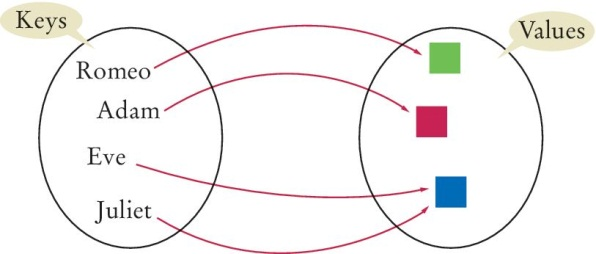
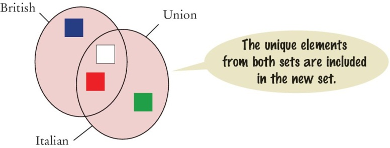
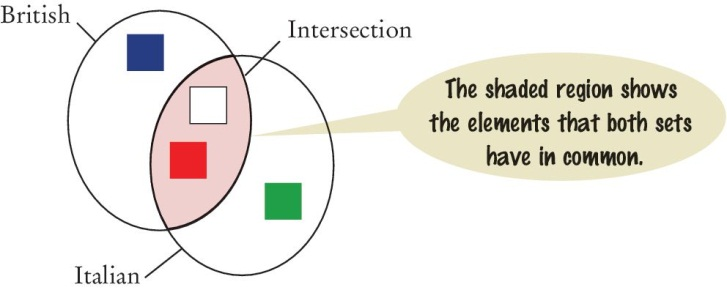
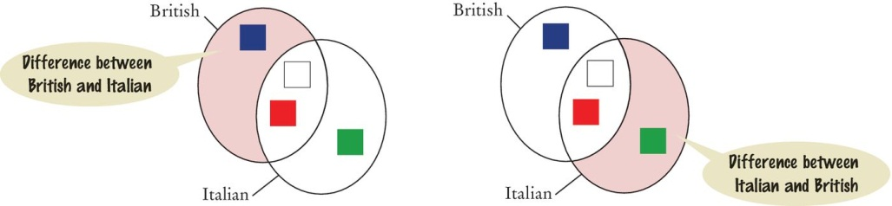

# Chapter Eight: Dictionaries and Sets

A list finds a value by its **position**: `names[2]`. That works well when the order matters, but often you want to look something up by a **name** instead, such as a phone number by person, a price by product, or a count by word. A **dictionary** stores pairs of **keys** and **values**, so you can go straight from a key to its value. Dictionaries are among the most used containers in Python. You have already used one in Chapter 6, where AWS sent back its answers as dictionaries. This chapter also covers **sets**, which store unique values with no order, and shows how to combine dictionaries, lists, and sets to model real data.

[← Back to Course Index](../table-of-contents.md)

---

## Chapter Goals

In this chapter you will **learn**:

- To create a dictionary and to look up, add, change, and remove its entries
- To loop over the keys, values, and items of a dictionary
- To use dictionaries for counting, lookup tables, and grouping
- To create a set and use set operations to process data
- To combine containers, as in a dictionary of lists or a dictionary of sets

---

## Chapter Contents

- **8.1 Dictionaries** — Keys and values, lookup, `get`, adding, changing, and removing entries
- **8.2 Looping Over a Dictionary** — `keys`, `values`, `items`, and sorted order
- **8.3 Common Dictionary Algorithms** — Counting, lookup tables, grouping, and finding the largest value
- **8.4 Sets** — Unique values, membership, and union, intersection, and difference
- **8.5 Combining Containers** — Customer purchases with a dictionary of sets

---

## 8.1 Dictionaries

### Keys and Values

A **dictionary** is a container that keeps **associations** between **keys** and **values**:

- Every key has exactly one value.
- **Keys are unique.** The same value, however, may belong to several keys.
- You look a value up **by its key**, not by its position.

The diagram shows the favorite colors of four people. Each name is a key, and each color is a value. Eve and Juliet both like blue, so two keys share one value.



### Creating a Dictionary

Write the pairs inside **braces** `{}`, with a colon between each key and its value:

```python
contacts = {"Fred": "723-5591", "Mary": "384-1212", "Bob": "384-1212", "Sarah": "221-3278"}
```

The names are the keys, and the phone numbers are the values. Mary and Bob share a number, which is fine, because only keys must be unique.

The phone numbers are stored as **strings**, not numbers. A phone number is not something you do arithmetic with, and as an `int` it would lose any leading zero.

An empty pair of braces makes an **empty dictionary**, which you can fill later:

```python
favorite_colors = {}
```

**Keys** must be **immutable**: numbers, strings, and tuples work, but a list cannot be a key. **Values** can be anything, including lists and other dictionaries.

### Looking Up a Value: `[]`

Put the key in square brackets to get its value:

```python
print(contacts["Fred"])   # 723-5591
```

The key **must exist**. Looking up a missing key raises a **`KeyError`**:

```python
print(contacts["John"])
```

```text
KeyError: 'John'
```

A dictionary has no positions, so `contacts[0]` does not mean "the first entry". It means "the value whose key is `0`", and here that is also a `KeyError`.

### Checking for a Key: `in`

To avoid the error, test for the key first with **`in`** (or **`not in`**). Like all dictionary operations, `in` looks at the **keys**, not the values:

```python
if "John" in contacts:
    print(f"John's number is {contacts['John']}.")
else:
    print("John is not in your contacts.")
```

### Looking Up with a Default: `get`

**`get(key, default)`** returns the value if the key exists, and the default if it does not. It never raises an exception:

```python
number = contacts.get("John", "unknown")
print(f"Dial {number}")   # Dial unknown
```

Without a second argument, `get` returns `None` for a missing key. `get` is especially useful for counting, as you will see in §8.3.

### Adding and Changing Entries

Assigning to `dictionary[key]` **adds** the entry if the key is new, and **replaces** the value if the key is already there:

```python
contacts["John"] = "457-8102"   # Adds John
contacts["John"] = "222-8102"   # Replaces John's number
```

There is never more than one entry for John. This is how you build a dictionary one entry at a time:

```python
favorite_colors = {}
favorite_colors["Juliet"] = "blue"
favorite_colors["Adam"] = "red"
favorite_colors["Eve"] = "blue"
favorite_colors["Romeo"] = "green"
```

### Removing Entries: `pop` and `clear`

**`pop(key)`** removes the entry with that key and returns its value:

```python
freds_number = contacts.pop("Fred")   # freds_number is "723-5591"
```

Like `[]`, `pop` raises a `KeyError` if the key is missing. Give it a default as a second argument and it returns the default instead:

```python
contacts.pop("Zoe", None)   # Zoe is not there: returns None, no error
```

**`clear()`** removes every entry, leaving an empty dictionary.

### Size: `len`

As with lists, **`len`** gives the number of entries, that is, the number of key–value pairs:

```python
contacts = {"Fred": "723-5591", "Mary": "384-1212", "Bob": "384-1212", "Sarah": "221-3278"}
print(len(contacts))   # 4
```

### Copying a Dictionary

A dictionary is **mutable**, and a dictionary variable holds a **reference**, just like a list variable (§5.1). Assigning it to another variable makes an **alias**, not a copy. To get a separate copy, use **`dict()`**:

```python
prices = {"coffee": 2.50, "tea": 2.00}
same_prices = prices          # Alias: both names refer to the same dictionary
copied_prices = dict(prices)  # A separate copy

prices["tea"] = 2.25
print(same_prices["tea"], copied_prices["tea"])   # 2.25 2.0
```

For the same reason, a function that changes a dictionary passed to it changes the caller's dictionary (§5.4).

### Reference: Common Dictionary Operations

| Operation                    | Meaning                                                                         |
| ---------------------------- | ------------------------------------------------------------------------------- |
| `d = {}`                     | Creates an empty dictionary.                                                    |
| `d = {k1: v1, k2: v2}`       | Creates a dictionary with the given entries.                                    |
| `d = dict(other)`            | Creates a copy of `other`.                                                      |
| `len(d)`                     | Returns the number of entries.                                                  |
| `key in d`, `key not in d`   | Tests whether `key` is in the dictionary.                                       |
| `d[key]`                     | Returns the value for `key`. Raises `KeyError` if it is missing.                |
| `d.get(key, default)`        | Returns the value for `key`, or `default` if it is missing.                     |
| `d[key] = value`             | Adds the entry, or replaces the value if `key` is already there.                |
| `d.pop(key)`                 | Removes the entry and returns its value. Raises `KeyError` if it is missing.    |
| `d.pop(key, default)`        | Same, but returns `default` instead of raising if `key` is missing.             |
| `d.clear()`                  | Removes all entries.                                                            |
| `d.keys()`, `d.values()`, `d.items()` | The keys, the values, or the `(key, value)` pairs, for use in a `for` loop (§8.2). |

---

## 8.2 Looping Over a Dictionary

### Looping Over the Keys

A `for` loop over a dictionary visits its **keys**. Dictionaries remember the order in which keys were **first added**, so that is the order you get:

```python
contacts = {"Fred": "723-5591", "Mary": "384-1212", "Bob": "384-1212", "Sarah": "221-3278"}
contacts["John"] = "457-8102"

for name in contacts:
    print(name)
```

```text
Fred
Mary
Bob
Sarah
John
```

Changing the value of an existing key does not move it. Removing a key and adding it again puts it at the end.

### Looping Over Keys and Values: `items`

Most of the time you want both the key and its value. **`items()`** gives you the pairs, as tuples, and you can unpack each one into two variables (§5.5):

```python
for name, number in contacts.items():
    print(f"{name:10}{number}")
```

```text
Fred      723-5591
Mary      384-1212
Bob       384-1212
Sarah     221-3278
John      457-8102
```

This is clearer than looping over the keys and then looking up `contacts[name]` each time.

If you need only one part, **`keys()`** gives the keys and **`values()`** gives the values:

```python
for number in contacts.values():
    print(number)
```

### Looping in Sorted Order

**`sorted()`** works on a dictionary too. It returns a **list** of the keys in sorted order, and does not change the dictionary:

```python
for name in sorted(contacts):
    print(f"{name:10}{contacts[name]}")
```

```text
Bob       384-1212
Fred      723-5591
John      457-8102
Mary      384-1212
Sarah     221-3278
```

### ⚠️ Common Error: Changing the Size While Looping

Do not add or remove keys in a `for` loop that is going over the same dictionary. Suppose you want to remove everyone whose number is `384-1212`:

```python
for name, number in contacts.items():
    if number == "384-1212":
        contacts.pop(name)    # Error: removes a key while looping
```

Python stops with:

```text
RuntimeError: dictionary changed size during iteration
```

Instead, use **two loops**. The first loop only collects the keys to remove in a list. The second loop goes over that list, not the dictionary, so it is safe to remove the keys there:

```python
to_remove = []
for name, number in contacts.items():
    if number == "384-1212":
        to_remove.append(name)

for name in to_remove:
    contacts.pop(name)

print(contacts)
```

```text
{'Fred': '723-5591', 'Sarah': '221-3278', 'John': '457-8102'}
```

Changing the **values** of existing keys inside the loop is fine. Only adding or removing keys causes the error.

---

## 8.3 Common Dictionary Algorithms

### Counting

To count how often each value occurs, use a dictionary whose keys are the values and whose values are the counts. The first time you see a word, it is not in the dictionary yet, so `get` with a default of `0` handles both cases in one line:

```python
counts[word] = counts.get(word, 0) + 1
```

Here is the same step written out with `if`, which does exactly the same thing:

```python
if word in counts:
    counts[word] = counts[word] + 1
else:
    counts[word] = 1
```

### Example: Word Frequencies

This program counts how often each word occurs in a sentence:

```python
text = "the cat sat on the mat and the dog sat with the cat"

counts = {}
for word in text.split():
    counts[word] = counts.get(word, 0) + 1

print(counts)
print(f"There are {len(counts)} different words.")
```

```text
{'the': 4, 'cat': 2, 'sat': 2, 'on': 1, 'mat': 1, 'and': 1, 'dog': 1, 'with': 1}
There are 8 different words.
```

The first time the loop meets `"cat"`, `get` returns the default `0`, so its count becomes `1`. The second time, `get` returns `1`, so its count becomes `2`. Each different word is one key, so `len(counts)` is the number of different words.

### Finding the Largest Value

To find the word that occurs most often, use the maximum algorithm from §5.3, but loop over the **items**, so that you keep track of the key as well as the value:

```python
most_common = ""
highest = 0
for word, count in counts.items():
    if count > highest:
        most_common = word
        highest = count

print(f"The most common word is '{most_common}' ({highest} times).")
```

```text
The most common word is 'the' (4 times).
```

`max(counts)` would **not** do this. It returns the largest **key**, which is the word that comes last in alphabetical order: `'with'`.

### Lookup Tables

A dictionary can replace a long chain of `if`/`elif` statements that converts one value into another. The dictionary is a **table**: look up the input, and the value is the answer. If the table never changes while the program runs, name it as a constant:

```python
GRADE_POINTS = {"A": 4.0, "B": 3.0, "C": 2.0, "D": 1.0, "F": 0.0}

grades = ["A", "B", "A", "C"]
total = 0.0
for grade in grades:
    total = total + GRADE_POINTS[grade]

print(f"GPA: {total / len(grades):.2f}")   # GPA: 3.25
```

To change or extend the table later, you edit one line of data instead of rewriting the `if` statements. If the input might not be in the table, check with `in` first or use `get`.

### Grouping: A Dictionary of Lists

A value can be a list. That lets you **group** items: each key collects all the items that belong to it. This program groups fruits by their first letter. When a letter appears for the first time, it creates an empty list for it, then appends:

```python
fruits = ["apple", "banana", "cherry", "avocado", "blueberry", "apricot"]

by_letter = {}
for fruit in fruits:
    letter = fruit[0]
    if letter not in by_letter:
        by_letter[letter] = []
    by_letter[letter].append(fruit)

print(by_letter)
```

```text
{'a': ['apple', 'avocado', 'apricot'], 'b': ['banana', 'blueberry'], 'c': ['cherry']}
```

`by_letter[letter].append(fruit)` looks up the list for that letter and appends to it directly. The list is changed in place, so there is no need to store it back in the dictionary.

---

## 8.4 Sets

### What Is a Set?

A **set** stores a collection of **unique** values:

- Adding a value that is already there has no effect, so there are never duplicates.
- A set has **no order**, so there is no first or second element, and `[0]` does not work on a set.
- Checking whether a value is in a set is very fast, even for a large set.

A set is like a dictionary that has keys but no values. Like dictionary keys, set elements must be **immutable**: numbers, strings, and tuples, but not lists.

### Creating a Set

Write the elements in braces, or convert a list with **`set()`**. Converting a list is a quick way to remove its duplicates:

```python
british = {"red", "white", "blue"}

names = ["Emma", "Jack", "Emma", "Olivia", "Jack"]
unique_names = set(names)
print(len(unique_names))   # 3
```

### ⚠️ Common Error: `{}` Is Not an Empty Set

Empty braces make an empty **dictionary**, not an empty set. To make an empty set, call `set()` with no arguments:

```python
skills = set()   # An empty set
lookup = {}      # An empty dictionary
```

### Adding, Removing, and Testing

```python
skills = {"Python", "Excel", "SQL"}
skills.add("Java")         # Java is added
skills.add("SQL")          # Already there: no effect

skills.discard("Java")     # Java is removed
skills.discard("C++")      # Not there: no effect

if "Python" in skills:
    print("This applicant knows Python.")
```

There is also **`remove()`**, which raises a `KeyError` if the value is not in the set. Use `discard` unless a missing value really is an error.

### Looping Over a Set

A `for` loop visits every element, but the order is **unpredictable** and can change from one run to the next. To get a predictable order, loop over **`sorted(skills)`**, which returns a sorted list:

```python
for skill in sorted(skills):
    print(skill)
```

```text
Excel
Python
SQL
```

### Example: Counting Different Words

The word frequency program in §8.3 used a dictionary because it needed a count for each word. If you only need to know **which** words occur, a set is enough:

```python
text = "the cat sat on the mat and the dog sat with the cat"

unique_words = set(text.split())
print(f"There are {len(unique_words)} different words.")   # 8
```

**Programming tip:** when you collect unique values, use a set, not a list. The list version needs `if word not in word_list:` before each `append`, and `in` on a list has to check the elements one by one. On a set, `in` and `add` stay fast however large the set gets.

### Set Operations

Sets support the operations from mathematics. Each one returns a **new** set and does **not** change the sets it is called on. Here are the colors of three flags:

```python
british = {"red", "white", "blue"}
italian = {"red", "white", "green"}
canadian = {"red", "white"}
```

The **union** contains the elements that are in **either** set:

```python
in_either = british.union(italian)   # {'red', 'white', 'blue', 'green'}
```



The **intersection** contains the elements that are in **both** sets:

```python
in_both = british.intersection(italian)   # {'red', 'white'}
```



The **difference** contains the elements of the first set that are **not** in the second. The order matters:

```python
print(british.difference(italian))   # {'blue'}
print(italian.difference(british))   # {'green'}
```



A set is a **subset** of another if every one of its elements is also in the other set. Two sets are **equal** if they have exactly the same elements, in any order:

```python
print(canadian.issubset(british))   # True
print(italian.issubset(british))    # False: green is not in the British flag
print(british == {"blue", "white", "red"})   # True
```

When Python prints a set, the elements can appear in any order. The examples above show one possible order.

### Reference: Common Set Operations

| Operation                    | Meaning                                                              |
| ---------------------------- | -------------------------------------------------------------------- |
| `s = set()`                  | Creates an empty set.                                                |
| `s = {e1, e2, e3}`           | Creates a set with the given elements.                               |
| `s = set(sequence)`          | Creates a set from the elements of a list, string, or other sequence. |
| `len(s)`                     | Returns the number of elements.                                      |
| `e in s`, `e not in s`       | Tests whether `e` is in the set.                                     |
| `s.add(e)`                   | Adds `e`. No effect if it is already there.                          |
| `s.discard(e)`               | Removes `e`. No effect if it is not there.                           |
| `s.remove(e)`                | Removes `e`. Raises `KeyError` if it is not there.                   |
| `s.clear()`                  | Removes all elements.                                                |
| `s.union(t)`                 | Returns a new set with the elements in `s` or `t`.                   |
| `s.intersection(t)`          | Returns a new set with the elements in both `s` and `t`.             |
| `s.difference(t)`            | Returns a new set with the elements in `s` that are not in `t`.      |
| `s.issubset(t)`              | Returns `True` if every element of `s` is in `t`.                    |
| `s == t`, `s != t`           | Tests whether the sets have the same elements.                       |

---

## 8.5 Combining Containers

### Example: Customer Purchases

An office supply store keeps a list of its orders. Each order is a string holding the customer's name and the product they bought:

```python
orders = ["Emma:ink", "Jack:stapler", "Emma:paper", "Emma:ink", "Olivia:pens", "Jack:paper", "Emma:ink"]
```

Customers often buy the same product again: Emma has ordered ink three times. The store wants to know **which** products each customer has bought, with each product listed once.

### Choosing the Containers

- We look up products **by customer** → a **dictionary** with the customer names as keys.
- Each customer has bought many products, and we want **no duplicates** → the value is a **set** of products.

So the program uses a **dictionary of sets**. It is the same grouping pattern as in §8.3, with two changes: an empty `set()` instead of an empty list, and `add` instead of `append`:

```python
purchases = {}
for order in orders:
    fields = order.split(":")
    customer = fields[0]
    product = fields[1]
    if customer not in purchases:
        purchases[customer] = set()
    purchases[customer].add(product)

for customer, products in purchases.items():
    print(f"{customer}: {', '.join(sorted(products))}")
```

```text
Emma: ink, paper
Jack: paper, stapler
Olivia: pens
```

Emma ordered ink three times, but the set keeps only one copy, so ink is listed once. With a list in place of the set, Emma's line would read `ink, paper, ink, ink`.

### Which Container Should You Use?

| You need to …                                              | Use          |
| ---------------------------------------------------------- | ------------ |
| Keep values in order, or get them by position              | A list       |
| Keep a fixed group of values that must not change          | A tuple      |
| Look a value up by a key, such as a name or an id          | A dictionary |
| Keep unique values, or test quickly whether a value is present | A set        |

---

## Key Takeaways

1. A **dictionary** stores **key–value** pairs. Keys are unique and must be immutable; values can be anything. Create one with `{key: value, ...}`, or start with `{}` and add entries
2. **`d[key]`** looks up a value and raises a **`KeyError`** if the key is missing. Check first with **`in`**, or use **`d.get(key, default)`**
3. **`d[key] = value`** adds a new entry or replaces an existing value. **`pop(key)`** removes an entry and returns its value
4. A `for` loop over a dictionary visits the **keys**, in the order they were added. Use **`items()`** to get keys and values together, and **`sorted(d)`** for the keys in sorted order. Do not add or remove keys while looping over the dictionary
5. Common patterns: **counting** with `counts[key] = counts.get(key, 0) + 1`, **lookup tables** instead of long `if`/`elif` chains, and **grouping** with a dictionary of lists
6. A **set** stores unique values with no order. Create an empty one with **`set()`**, because `{}` is an empty dictionary. Use `add`, `discard`, and `in`; **`union`**, **`intersection`**, and **`difference`** return new sets
7. Containers can hold other containers. Choose them by what the problem needs, as in a **dictionary of sets** for customer purchases

---

*End of Chapter Eight*

[← Back to Course Index](../table-of-contents.md)
